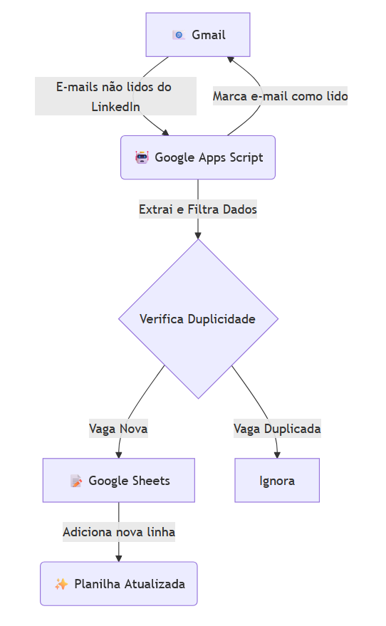

<h1>📬 Filtro de E-mails de Vagas do LinkedIn</h1>

Um script de automação para filtrar alertas de vagas do LinkedIn recebidos no Gmail e organizá-los em uma planilha do Google Sheets.

<!-- Badges -->

  
  
  
  

---

## 📖 Sumário

*   [🎯 Sobre o Projeto](#-sobre-o-projeto)
*   [✨ Funcionalidades](#-funcionalidades)
*   [🛠️ Tecnologias Utilizadas](#-tecnologias-utilizadas)
*   [🚀 Como Instalar e Executar](#-como-instalar-e-executar)
    *   [Passo 1: Preparar a Planilha](#passo-1-preparar-a-planilha)
    *   [Passo 2: Configurar o Script](#passo-2-configurar-o-script)
    *   [Passo 3: Automatizar com Gatilhos](#passo-3-automatizar-com-gatilhos)
*   [📈 Status do Projeto](#-status-do-projeto)
*   [📝 Licença](#-licença)
*   [✍️ Autor](#-autor)

## 🎯 Sobre o Projeto

Este script foi criado para resolver um problema comum: o grande volume de e-mails de alerta de vagas do LinkedIn. Em vez de verificar manualmente cada e-mail, esta automação lê sua caixa de entrada do Gmail, extrai as informações mais importantes (vaga, empresa, local e link) e as organiza de forma limpa em uma planilha do Google Sheets.

O processo é totalmente automatizado, evitando vagas duplicadas e filtrando posições que não se encaixam no seu perfil (como "estágio" ou "sênior"), economizando tempo e mantendo sua busca por emprego organizada.

### Diagrama de Fluxo

  

## ✨ Funcionalidades

*   **🔍 Leitura Inteligente:** Busca e processa apenas e-mails não lidos de alertas de vagas do LinkedIn.
*   **📊 Extração de Dados:** Captura automaticamente o título da vaga, nome da empresa, localização e o link direto para a candidatura.
*   **🚫 Filtro de Palavras-Chave:** Permite criar uma lista de termos (ex: "estágio", "sênior") para ignorar vagas que não são do seu interesse.
*   **✔️ Anti-Duplicidade:** Verifica se o link da vaga já existe na planilha antes de adicioná-lo, garantindo uma lista sempre limpa.
*   **🤖 Automação Completa:** Após configurado, o script pode rodar sozinho em intervalos de tempo definidos (ex: a cada hora, uma vez por dia).
*   **🧹 Organização:** Marca os e-mails como lidos no Gmail após o processamento, mantendo sua caixa de entrada organizada.

## 🛠️ Tecnologias Utilizadas

Este projeto foi construído com as seguintes ferramentas do ecossistema Google:

*   **[Google Apps Script](https://script.google.com/)**: Plataforma de desenvolvimento rápido que torna fácil e rápido criar aplicações que se integram com os serviços do Google.
*   **[Google Sheets](https://sheets.google.com/)**: Usado como banco de dados para armazenar e organizar as vagas coletadas.
*   **[Gmail](https://gmail.com/)**: Usado como fonte de dados para a extração das informações das vagas.
*   **[Gemini](https://gemini.google.dev/)**: Utilizado para gerar o código do script e fornecer suporte durante o desenvolvimento.

## 🚀 Como Instalar e Executar

Siga o passo a passo abaixo para configurar a automação na sua própria conta Google.

### Passo 1: Preparar a Planilha

1.  Crie uma nova planilha no **[Google Sheets](https://sheets.new)**.
2.  Na primeira linha (cabeçalho), defina as seguintes colunas:
    *   `A1`: **DATA**
    *   `B1`: **EMPRESA**
    *   `C1`: **LOCAL**
    *   `D1`: **VAGA**
    *   `E1`: **LINK**
3.  Renomeie a aba da planilha para `Página1` ou, se preferir outro nome, lembre-se de atualizá-lo na primeira linha do código-fonte.

### Passo 2: Configurar o Script

1.  Na sua planilha, vá até o menu `Extensões` > `Apps Script`.
2.  O editor de script será aberto em uma nova aba. Apague todo o conteúdo que vier por padrão.
3.  Copie o código do arquivo `Código.js` e cole no editor.
4.  Clique no ícone de **Salvar projeto** (💾).
5.  Para testar e conceder as permissões, clique em **Executar**. A primeira execução solicitará autorização:
    *   Clique em `Revisar permissões` e escolha sua conta Google.
    *   Você verá um aviso de segurança. Clique em `Avançado` e depois em `Acessar <nome-do-projeto> (não seguro)`.
    *   Por fim, clique em `Permitir`.

> **Dica:** Antes de executar pela primeira vez, deixe alguns e-mails de vagas do LinkedIn como "não lidos" no seu Gmail para que o script tenha dados para processar.

### Passo 3: Automatizar com Gatilhos

Para que o script rode sozinho, crie um "acionador" (gatilho):

1.  No menu lateral esquerdo do Apps Script, clique no ícone de **Acionadores** (⏰).
2.  Clique no botão `+ Adicionar acionador` no canto inferior direito.
3.  Configure o acionador da seguinte forma:
    *   **Função a ser executada:** `extrairVagasLinkedIn`
    *   **Origem do evento:** `Baseado no tempo`
    *   **Tipo de acionador:** `Temporizador de horas` (ou o intervalo que preferir)
    *   **Selecione o intervalo:** `A cada hora` (ou `A cada 4 horas`, `Diariamente`, etc.)
4.  Clique em **Salvar**.

Pronto! A automação está configurada e irá rodar automaticamente no intervalo que você definiu.

## 📈 Status do Projeto

✔️ **Concluído:** O projeto está finalizado e totalmente funcional. Não há planos para novas funcionalidades, mas correções de bugs serão bem-vindas.

## 📝 Licença

Este projeto está sob a licença MIT. Veja o arquivo [LICENSE.txt](LICENSE.txt) para mais detalhes.

## ✍️ Autor

**Laís Brum**

[LinkedIn](https://www.linkedin.com/in/lais-brum/) | [GitHub](https://github.com/laisbrum) | [E-mail](mailto:eng.laisbm@gmail.com)